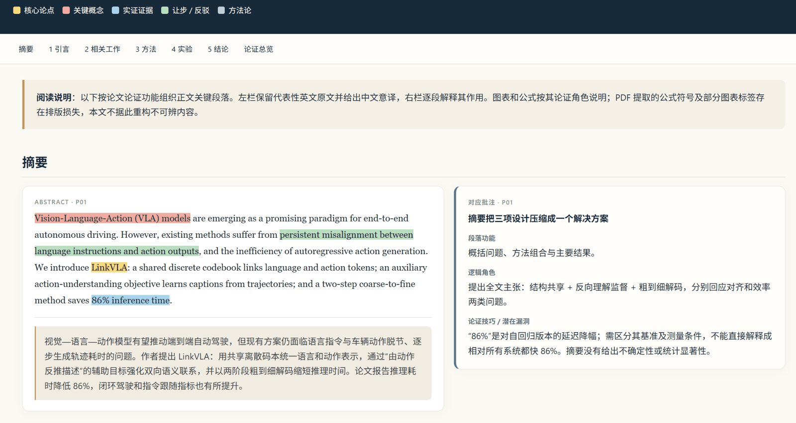

<div align="center">

# 论证脉络
### 学术论文双栏批注 · Academic Argument Annotation

**读懂论文如何论证，而不只是它说了什么。**

[](https://agentskills.io)
[](https://help.openai.com/en/articles/20001066-skills-in-chatgpt)
[](LICENSE)

**长论文拆章读 · 中英逐段对照 · 论证链可视化 · 一键生成 HTML**



[快速开始](#快速开始) · [功能特色](#一份论文如何变成一张论证地图) · [ChatGPT 安装](#chatgpt一次安装持续使用) · [Codex 安装](#codex-及其他-agent) · [项目结构](#项目结构)

</div>

---

> 一篇论文的价值，不只在结论，也在它如何走到结论。
> **论证脉络**把论文拆解成可追踪的主张、证据、方法与反驳，再把它们编织成一份清晰、可浏览的双栏批注页。

## 快速开始

安装一次后，直接在 ChatGPT 中输入：

`@论证脉络｜学术论文双栏批注`

并上传论文 PDF，或提供论文文本/可访问链接，以及课程信息和 HTML 保存位置。Skill 安装后可持续使用，不需要每次对话重新复制或迁移文件。

## 一份论文如何变成一张论证地图

| 阅读层 | 你会看到什么 |
| --- | --- |
| 原文与译文 | 英文原文保留论证标记；中文以自然学术表达意译，并与原段对应 |
| 五类论证标记 | 🟨 核心论点　🟥 关键概念　🟦 实证证据　🟩 让步/反驳　🟪 方法论 |
| 逐段批注 | 段落功能、在论证链中的位置、有效技巧与潜在漏洞 |
| 全篇总览 | 问题 → 主张 → 证据 → 反驳/限定 → 结论，并提炼强项与薄弱处 |

### 长论文，分章读再合并

先逐章记录问题、主张、证据、异议和章节衔接，再跨章节校对术语与推理关系，最终重建完整论证链，避免长文摘要截断论证脉络。

### 表格与公式，先核对再排版

复杂表格或公式先整理成 Markdown 表格或结构化公式说明并对照原文核验，再嵌入 HTML。PDF 提取不清时标出待核验处，不补造数据或符号。

## ChatGPT：一次安装，持续使用

### 工作区 marketplace 安装（推荐）

本仓库包含 ChatGPT 工作区可导入的 GitHub marketplace 包。工作区管理员操作一次：

1. 打开 **Admin Console → Plugins → Add → Import marketplace**。
2. Source：`https://github.com/Zhangjian-maker/academic-argument-annotation`
3. Path：`.agents/plugins`；Branch：`main`。
4. 导入后在工作区设置中允许成员安装该插件/skill。成员各自安装一次后，即可持续使用；仓库更新可由管理员同步。

此方式要求工作区管理员权限，且受 ChatGPT 计划和工作区策略约束。公共 GitHub 仓库本身不会自动出现在所有用户的插件目录中。

### 个人 Skills 安装

符合条件的 ChatGPT 账号可在 **Plugins → Skills → Create → Upload from your computer** 上传 Skill 包。完成一次安装后即可在后续对话中直接调用，不需要反复搬运文件。个人 Skills 的可用性依账号计划与工作区设置而定。

## Codex 及其他 agent

下载 `academic-argument-annotation/` 文件夹并放入 agent 支持的 skills 目录。Codex 可放在个人 skills 目录，或项目的 `.agents/skills/`。其他 agent 按其 Agent Skills 安装方式操作。ChatGPT 与 Codex 的安装/同步机制可能不同。

## 项目结构

```text
.
├── academic-argument-annotation/
│   └── SKILL.md
├── .agents/plugins/
│   ├── marketplace.json
│   └── academic-argument-annotation/
│       ├── .codex-plugin/plugin.json
│       └── skills/academic-argument-annotation/SKILL.md
├── README.md
├── LICENSE
└── CONTRIBUTING.md
```

插件包内附有 Skill 副本，以支持安装后持续使用与 marketplace 更新。修改 Skill 时请同步更新两份文件。

## 项目原则

- **忠于原文：**不编造数据、引文、方法或作者立场；翻译保留限定条件。
- **让逻辑可见：**区分作者主张、证据、方法、让步和反驳。
- **诚实标注边界：**PDF 提取、公式识别或证据不足时明确指出。
- **结构服务阅读：**页面适配桌面和移动端，视觉帮助追踪推理。

## 参与改进

欢迎提交 Issue 或 Pull Request。请先阅读 [贡献指南](CONTRIBUTING.md)。论文原文版权归作者与出版方所有，提交时请勿附带未获授权传播的全文。

## License

本项目以 MIT License 发布，详见 [LICENSE](LICENSE)。

<div align="center">

**从读懂结论，到看见论证。**

</div>
